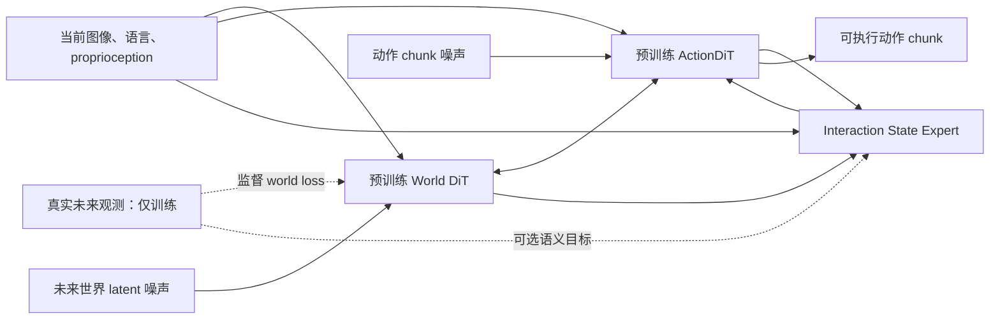

# StateWAM v2：世界先验支持的动态交互状态

日期：2026-09-12\
文档状态：v2 修订；待验证的是新版 StateWAM，用户 fork 上的 OpenWAM 真机训练已成功。

## 1. 核心研究定位

**目标：在保留 OpenWAM 世界先验与动作生成能力的前提下，学习一个任务相关、可受控制损失约束、能够随生成过程更新的交互状态接口。**

研究关注的不是模型能否再预测一次未来，也不是先把世界压到最小，而是：

> 世界分支中的哪些信息对机器人交互有用？显式组织这些信息，能否提高成功率、扰动恢复能力或数据效率？在此之后，能否减少传递和计算这些信息的成本？

第一版建议称为 **StateWAM v2-Interaction**。论文题目和最终能力描述待结果确定，暂不将其称为完整 world state、物理因果状态或已校准 belief state。

### 1.1 三个可以被推翻的假设

| 假设 | 支持它需要什么 | 什么结果会削弱它 |
|---|---|---|
| H1：显式交互状态有额外控制价值 | 超过相同初始化和训练预算的 OpenWAM 及容量匹配通路 | 增益只能由额外参数或更多训练解释 |
| H2：未来世界信息是增益的重要来源 | 未来可见状态超过当前信息状态；匹配的信息流实验一致 | 移除未来来源后性能不变 |
| H3：状态可以承载必要的未来信息 | 阻断直接 future-world→action 后仍保留足够性能 | 状态必须依赖直接未来通路才能工作 |

H1、H2 是首轮主问题；H3 是后续机制与压缩问题。不要让 H3 的失败自动否定 H1。

首轮 H1–H3 的细粒度结构比较优先在可控仿真中完成，真机负责验证结论在自有平台是否仍有用。仿真成功不等于灵巧手物理机制已被验证；仿真受控比较与真实交互收益分别报告。

### 1.2 与原版的关系

原版已经提供 future-conditioned 表征、EgoDex Prior 可预测性和跨域失败证据。本版保留这些证据与数据工具，但不强制保留原 Posterior/Prior 拓扑、四个 token、1 秒双腕终点位移主目标或 Human-first 训练阶段。

原来的双腕位移可以成为辅助解码目标；其用途是保留自身运动信息，不能单独证明状态掌握物体变化、接触或任务完成关系。

## 2. 继承什么，新增什么

以用户 [FeiyangHong/OpenWAM fork](https://github.com/FeiyangHong/OpenWAM) 为工程起点。本次核对 HEAD 为 `5be50682eb45ef5d2dace77cce88c3baa0c48446`，它在此前上游提交 `d8dd33d8576b475f5a5cdc6fb8ca902778a199b3` 上增加了本体/数据适配；核心 world/action 架构、训练 checkpoint loader 与部署目录在这两个提交之间无差异。实施前记录实际成功 run 的提交，不能把当前 HEAD 自动当作历史实验版本。

用户已验证两条路线：**Pretrain model→自有真机数据训练→良好效果**，以及 **Wuji model→自有真机数据训练→良好效果**。fork 文档对应列出了 `OpenWAM-Alpha-Pretrain-Foundation-Model` 和 `OpenWAM-Alpha-Real-Dexterous-Hand-Wuji`。具体权重文件与训练输出仍需校验；没有证据预先指定两者谁更好。

实验将初始化作为独立因素：仿真主矩阵默认从 Foundation 在对应仿真训练集微调；真机仅对胜出结构，在 Foundation 和 Wuji 两条初始化中分别与同初始化 OpenWAM 对照。不要将 Foundation 基线与 Wuji 初始化的 StateWAM 比较后，把差异归因于架构。已训练真机 checkpoint 可用于工程 smoke 或匹配的继续训练实验；正式独立测试必须审计其历史数据覆盖。

继承：

- Wan 世界生成骨干及其原始视觉 latent 空间；
- 独立 ActionDiT、原有文本与 proprioception 条件；
- 逐层世界—动作交互和原有 world/action flow-matching；
- 原 checkpoint 的视频窗口、动作 chunk、相机布局、归一化与推理 schedule。

真机侧具体保留 fork 的 `wuji_real_task` reader、转换脚本和训练入口。已核对契约为转换后的 `[L EEF9, L hand20, R EEF9, R hand20]` raw 58D、column rot6d，以及 80D 模型空间；这些是该 adapter 的数据定义，不等同于宣称所有候选灵巧手具有相同物理自由度。仿真侧使用各 benchmark 自身 adapter，不强套真机 raw 58D。

新增一个架构级 `InteractionStateExpert`，负责从**当前条件、正在生成的世界特征与动作特征**读取并组织少量状态 token，再把它们写入动作分支。

第一版不添加新的大型 VLM，不替换 Wan VAE，不引入独立 StateDiT 噪声调度器，不重新做大规模预训练。State Expert 是生成网络内部的确定性中间计算，但整个策略仍继承 world/action 采样的随机性；它不是原版 current-only deterministic Prior。

资源以用户确认的 8–16×A100 80 GB 为基础，主验证平台为已经完成复现的一种天机/星尘机械臂与舞肌/Sharpa 灵巧手组合。具体动作维度、相机布局和控制频率待按实际部署填入。

图中的 W↔A 是首轮保留的 OpenWAM 通路。后续 bottleneck 模式只移除 **future-world→action 的直接边**；当前视觉依然直接可见。图中的真实未来没有额外作为干净条件输入 State Expert。

## 3. 状态的定义与更新

记部署条件为：

\[
C_t=(O_t,S_t,L,e)
\]

其中首轮只采用基线已支持的条件；`e` 若尚无可靠定义，不增加随机 domain/embodiment 标签模块。跨域时再明确其来源与作用。历史观测也先按基线配置处理，不因原 EgoDex 结果而普遍判定 history 无用。

在去噪调用 \(n\)、网络层 \(\ell\) 上：

\[
W_{n,\ell}=[W^0_{n,\ell},W^f_{n,\ell}],\quad
A_{n,\ell}\in\mathbb R^{B\times H_A\times D_A}
\]

\(W^0\) 是受 clean-prefix 因果规则保护的当前帧特征，\(W^f\) 是带相应噪声的未来世界特征。它不是已经验证正确的未来，也不是部署时的真实未来。

状态读取器产生：

\[
Z_{n,\ell}=R_\ell(Q,C_t,W^0_{n,\ell},W^f_{n,\ell},
A_{n,\ell},\sigma_v,\sigma_a)
\in\mathbb R^{B\times K\times D_Z}
\]

建议首个可运行配置为 \(K=16,D_Z=512\)。这是工程起点，不是已证明的最小充分状态。后续只在获胜配置上测试 \(K\in\{8,16,32\}\)，不先做大网格。

### 3.1 读取器的具体构造

1. 初始化 K 个可学习 query；加入当前条件编码以及可选的时间锚点 embedding。
2. query cross-attend 到映射至 \(D_Z\) 的当前/未来 world hidden tokens；映射保留它们已经包含的时空信息。
3. 用当前动作 hidden tokens 和两种噪声等级调制 query 或进行一次额外 cross-attention。
4. 经过 LayerNorm 与小型 FFN，得到 Z。
5. 动作 query cross-attend 到 Z，结果投影回动作/共享 attention 接口要求的维度。

应使用固定形状、无 batch 间通信的实现。条件缺失时有显式 mask，不用无效 proprio 的零数值冒充真实状态。状态读取模块接收 world hidden tokens 的来源与维度必须在实现中固定；不要把已经施加 RoPE 的 Q/K 与未施加 RoPE 的 residual hidden 混用而不验证位置语义。

### 3.2 更新频率

首轮在全部去噪调用中计算 State。每个调用内，在选定网络层重新读取 State，不把上次去噪调用的 State 隐式缓存成历史记忆。

对 30 层基线，建议先在 0-based 层 `[4,9,14,19,24,29]` 加 State 读写。原有 world/action 30 层配对保持不变。这是单独的 `state_bridge_layers`，**不能通过把原 `bridge_interval` 改成 5 来实现**。层数不同则必须显式配置和校验。

第一版各 State 层独立读取，不要求独立状态 token 贯穿所有层递归传播。若动态读取有效，再比较共享参数、逐层持久状态和更密集更新。这样首轮能够明确测试“从持续生成的 world/action 特征中读取状态”，而不同时引入跨层记忆机制。

### 3.3 时间与物理尺度

先继承基线窗口，记录每个未来帧与动作的真实时间戳。可选时间锚点为该 chunk 的 25%、50%、75%、100%，各对应若干 queries；必须按时间戳匹配有效帧，并记录离散化误差。

不要直接沿用旧 1 秒目标，也不要通过 `num_frames` 猜测物理秒数。若锚点超出有效片段，关闭其监督。接触等细粒度问题可能需要更高时间分辨率，应另设 horizon 实验，不混入首轮结构比较。

### 3.4 状态语义的证据边界

学习 query 没有预先保证的物体身份、接触或因果语义。建议把以下能力作为 probe/标注评估：物体是否随手移动、抓取是否稳定、任务相对关系是否满足、自身运动是否可恢复。

只有有独立标注且跨 held-out episode 成立时，才能报告相应语义。query attention 热图和动作可解码性单独都不够。

## 4. 三种信息流模式

### 4.1 B0：原生 OpenWAM

不实例化或完全跳过 State 通路。用于固定原性能参照与实现一致性测试。

### 4.2 R：Residual-State，首轮主模型

原世界—动作路径保留，State 只给动作 attention 结果添加残差：

\[
U^{A\prime}_{n,\ell}
=U^A_{n,\ell}
+\tanh(\gamma_\ell)P_\ell
\operatorname{Attn}(Q^A_{n,\ell},K^Z_{n,\ell},V^Z_{n,\ell})
\]

再交给原 ActionDiT block suffix。State 不直接写回当前视觉 token；通过更新后的动作特征，可以在后续原 mutual 层中间接影响未来 world stream。

\(\gamma_\ell=0\) 初始化，其他投影采用非零标准初始化。这样初始输出应复现原模型；第一个 backward 允许 gate 先学习，后续 State 内部应获得非零梯度。不能同时把 gate 和整个输出支路都初始化为恒零，造成无法启动的支路。

此模式验证增量价值，**不能证明状态已经替代完整世界信息**。

### 4.3 B：Future-State Bottleneck，后续机制模型

动作直接读取当前视觉和动作上下文，但不能直接读取未来 world tokens；未来 world 信息须先通过 Z。world→world、future-world 读取动作的路径按基线保持，干净当前帧始终不读取动作、未来或未来相关 State。

| Query / Key 来源 | 当前 world W0 | 未来 world Wf | 动作 A | State Z |
|---|---:|---:|---:|---:|
| 当前 world W0 | 允许 | 禁止 | 禁止 | 禁止 |
| 未来 world Wf | 允许 | 按原 world mask | 按 mutual | 首版不直接读取 |
| State Z | 允许 | 允许 | 可开关 | 读取器内部处理 |
| 动作 A：R 模式 | 允许 | 允许 | 允许 | 允许 |
| 动作 A：B 模式 | 允许 | 禁止 | 允许 | 允许 |

该表表达模块信息依赖，不要求一次四模态全序列 attention。实现可以采用原 MoT 加顺序 State read/write；读取和写入发生在同一层的指定位置，避免循环依赖。

必须在**每层、每个去噪调用**审计旁路，包括 current token 被污染、context 中误放 future feature、残留 direct bridge。State 接收动作意味着它未必是独立于策略的环境状态；论文中应保留这一限定。

若从 R 切换到 B，需要单独适配并完整评估。直接在已训练 R 模型上关闭边只能做依赖性诊断，不能充当公平的 B 模型成绩。

### 4.4 C：Current-State 容量对照

采用与 R 相同的 query 数、投影与读写接口，State 只读因果保护的当前视觉、语言和 proprioception，去掉动作与未来输入。未来/动作投影仍保留或用同规模当前特征分支替代，报告有效参数与 FLOPs 差异。

该对照用于排除“多一条 attention 路径就有收益”。R 中未来与动作来源的贡献，之后再用 `future-only / future+action` 的嵌套对照分开。不能把只关闭 Wf、但仍读取已经融合 Wf 的 A 的配置称为 current-only。

在原 mutual 骨干中，Wf 自身也可能包含动作信息。因此 `future-only / future+action` 只隔离**额外直接 action→State 边**的贡献，不隔离所有动作反馈。若要研究全系统动作反馈，需另做固定 world mask 的匹配训练对照，并单独报告。

## 5. 训练目标：先控制收益，再语义约束

### 5.1 第一轮，仅继承原目标

\[
\mathcal L_0=\lambda_W\mathcal L_W^{FM}
+\lambda_A\mathcal L_A^{FM}
\]

噪声采样、loss mask、归一化与权重先继承基线。State 通过动作损失获得直接训练信号，在后续 mutual 层中也可能接收 world loss 的间接梯度。

训练期 \(\sigma_v,\sigma_a\) 按原实现独立采样；推理采用对应原 checkpoint 的同步去噪路径。同步指 world/action 生成进度，不等于机器人执行必须阻塞等待；执行器的同步/异步选择是另一个因素，首轮保持用户已经验证的配置。

### 5.2 第二轮，可选的真实未来语义监督

只有 R/C 的结构与控制证据建立后，才引入训练期冻结视觉教师 \(\phi\)。它编码**真实**当前/未来帧，作为标签来源；不替换 Wan 的 VAE，不把额外语义特征作为部署条件。

建议先用已有可用的冻结特征编码器；若没有，再选择一个并固定版本。DINO 类静态表征只提供视觉特征先验，不应被等同为完整生成动力学先验。

构造目标：

\[
F^*_{h,p}=\operatorname{sg}(\operatorname{Norm}(\phi(O_{t+\tau_h})_p))
\]

用轻量解码器从 Z、当前条件以及时间/空间 query 预测 \(\hat F_{h,p}\)，对有效位置计算：

\[
\mathcal L_{sem}=\frac{\sum_{h,p}m_{h,p}w(\sigma_v,\sigma_a)
[1-\cos(\hat F_{h,p},F^*_{h,p})]}{\sum_{h,p}m_{h,p}w(\sigma_v,\sigma_a)+\epsilon}
\]

\[
\mathcal L_1=\mathcal L_0+\lambda_{sem}\mathcal L_{sem}
\]

起始 `w=1` 作为简单基线；如果发现高噪声监督导致平均化，才在验证集比较有记录的噪声加权策略。不能只挑低噪声 probe 成绩当作部署预测能力。

第一版目标可用固定低分辨率空间网格，避免依赖不可靠的在线物体检测。由此保留背景预测的风险，必须设置“当前特征+同一语义 loss”对照，并通过交互标注评估是否超越场景外观。后续若有可靠物体/接触 ROI，再加入 masked weighting；没有真实标注时，不把运动显著区域当成接触真值。

训练语义解码器必须测试它是否绕过 Z、仅靠当前条件完成预测。采用无 Z 解码器、置换 Z 以及匹配训练的 ablation；不要求 latent 在任意坐标系上逐元素拟合一个未经约束的 Posterior。

### 5.3 可选物理目标

有可靠标注时增加 wrist/EEF motion、gripper 或物体相对变化的辅助目标，并按 validity mask、单位和坐标规范计算。起初逐项加入，不把多个新 loss 合成一个难以解释的包。

接触、抓取稳定性、任务完成等目标只在标签有来源、质量审计和训练/测试分割时启用。动作标签不是物体交互成功标签。

## 6. 训练与部署的信息边界

| 信息 | 训练 | 部署 |
|---|---|---|
| 当前图像、任务、有效 proprioception | 条件 | 条件 |
| 真实未来视觉 latent | 原 flow matching 的加噪样本/目标 | 不存在；从噪声生成 |
| 干净未来语义特征 | 可选监督标签 | 不存在 |
| 真实动作 | 加噪动作与监督目标 | 不存在；生成动作 |
| State Z | 从当前条件与带噪 world/action 特征读取 | 从当前条件与正在生成的 world/action 特征读取 |

在训练低噪声时 Z 能接触接近真实未来的特征，这是原扩散/flow 训练的一部分，不是额外的 deployable oracle。正因存在这种差别，**仅在 teacher-forced/低噪声输入上的 state probe 成功不能作为部署结论**。

不把真实未来追加到语言，不从整个 episode 的事后描述生成部署 instruction，不跨 reset 采样，验证/测试划分先于窗口与教师缓存生成。

## 7. 人类数据和旧 Prior 的新位置

首轮使用仿真机器人数据做闭环结构比较，再用自有真机数据验证少量候选，不要求先完成 Human-only state pretraining。

后续人类视频可监督 world loss 与可选 semantic loss。没有机器人动作标签时，动作/proprioception 槽有显式有效性 mask，不将人体腕部位移写成机器人可执行动作。若需要在 human-only batch 更新 State，必须实现和测试“无有效动作时 State 仍可通过 world-only 或 semantic 路径学习”的分支；不能假定现有双系统早退路径会自动训练新增模块。

loss mask 也不等于输入不可见。无动作标注样本应采用明确的无动作读取分支，避免 State/world 把填充的随机动作 token 当作有效动作条件；可先分离 human/robot micro-batch 路径，再实现混合 batch 的样本级 mask。

HoloAssist 只有在质量审计与独立 robot 指标支持时才恢复为 auxiliary 数据源。不要把“world-only loss 下降”解释为跨域部署改进。

旧 EgoDex Prior 留作低成本预测状态对照；只有在新版已确定哪些信息有用后，才重新研究当前条件 student \(P_\theta(C_t)\) 或联合条件分布 \(p_\theta(Z,A\mid C_t)\)。多候选/随机 Prior 必须解决候选选择与闭环执行，而非只提高 oracle best-of-N。

## 8. 压缩与蒸馏作为后续分支

R 模式增加计算；B 模式保留完整 world stream，也不保证加速。首轮不能宣称部署效率改善。

只有 H3 得到支持，才选择以下一个分支：减少 State/world 读取频率、降低未来 latent 分辨率/时间长度、或训练免完整 world rollout 的 student。每种分支都重新测成功率、p50/p95 端到端延迟、显存和扰动恢复。

教师在真实未来上产生的状态与教师部署 rollout 的状态应分开存储。student 只对真实未来教师做回归可能重现旧 Prior 的不可预测性缺口；应比较闭环教师状态、动作分布蒸馏与任务结果，而不是仅追求 latent MSE。

## 9. 第一版规格冻结表

| 项目 | 初始选择 | 状态 |
|---|---|---|
| 工程底座 | 用户 fork 的已验证提交，核对 HEAD 为 5be5068 | 成功 run SHA 待填 |
| 仿真初始化 | Foundation→对应仿真数据；所有结构相同来源 | 首轮固定 |
| 真机初始化 | Foundation / Wuji 两条，分别匹配基线 | 两类均已获用户实证 |
| 世界与动作空间 | 保持基础 checkpoint 一致 | 首轮固定 |
| State | K=16、D=512，独立于 proprio 的 `state_dim` | 建议起点 |
| State 更新层 | 30 层模型的 4/9/14/19/24/29 | 验证后可调整 |
| 原 MoT 层数 | 保持 30 层一一配对 | 首轮固定 |
| 主模式 | gated residual，初始 gate=0 | 第一版 |
| 主损失 | 原 world/action flow matching | 第一版 |
| 额外语义教师 | 关闭 | 第二轮消融 |
| Human 扩展 | 关闭 | 机器人证据后 |
| 独立 Prior / state sampler | 不添加 | 条件性后续 |
| State 跨推理调用缓存 | 不添加 | 首轮固定 |
| 推理优化 | 先 eager、无近似 velocity cache 做一致性；再恢复基线优化 | 工程验证步骤 |

首轮结果若显示只有更大网络容量有用，应调整或关闭 State 主张；若状态通路有增益但压缩失败，可以保留交互接口方向；若均无增益，停止加复杂度并回到基线失败分析。

## 10. 核对依据

- [用户 fork，固定核对提交](https://github.com/FeiyangHong/OpenWAM/tree/5be50682eb45ef5d2dace77cce88c3baa0c48446)
- [fork 中两类模型训练与本体适配说明](https://github.com/FeiyangHong/OpenWAM/blob/5be50682eb45ef5d2dace77cce88c3baa0c48446/docs/grasp_anything_wuji_usage.md)
- [OpenWAM 官方仓库，固定提交](https://github.com/OpenWAM-Official/OpenWAM/tree/d8dd33d8576b475f5a5cdc6fb8ca902778a199b3)
- [OpenWAM 论文](https://arxiv.org/abs/2609.07398)，用于区分表征、交互与泛化结论；本方案的 State Reader、gate 和阶段顺序是新提案，不是论文已验证结论。
- [源码接口与工程风险清单](03_OpenWAM_Implementation_Map.md)
- [仿真先行的实验规格](04_Simulation_Protocol.md)
